# Inkless

**The ledger that writes itself.**

Inkless is an Android expense tracker built around how students in India actually pay: lots of small UPI payments — chai, canteen, autos, Swiggy, recharges — spread across GPay, PhonePe, Paytm and bank apps. Inkless reads the SMS your bank already sends for every UPI payment and adds the payment for you, so the ledger fills itself with zero typing. Every payment is filed into a category tab, so you can see at a glance where the month's money went.

It's local-first: your ledger lives in a database on your phone, and the SMS text never leaves it. The internet is only used for Firebase: signing in, the cloud backup you can switch off, and splits you share with friends who use Inkless too.

<p align="center">
  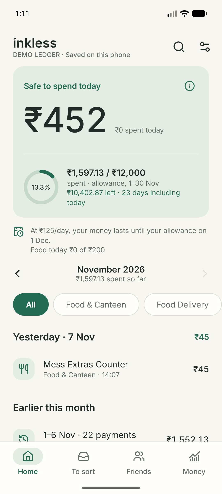
  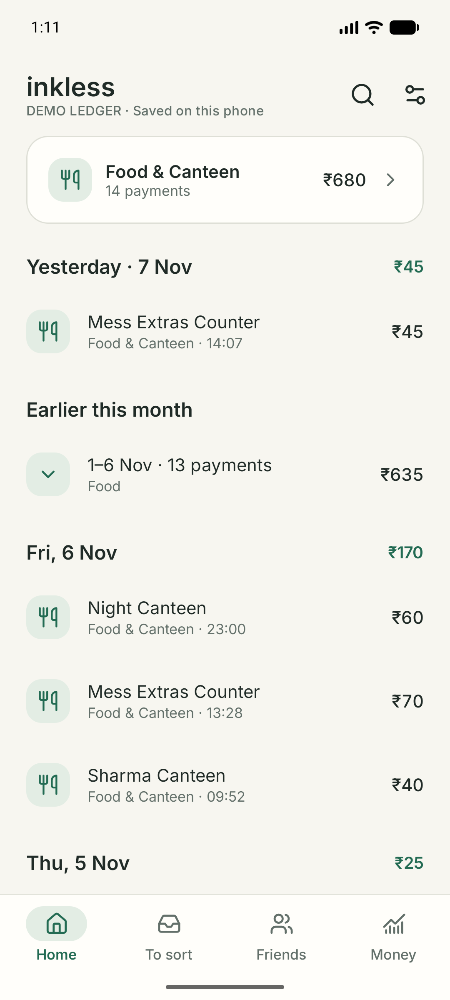
  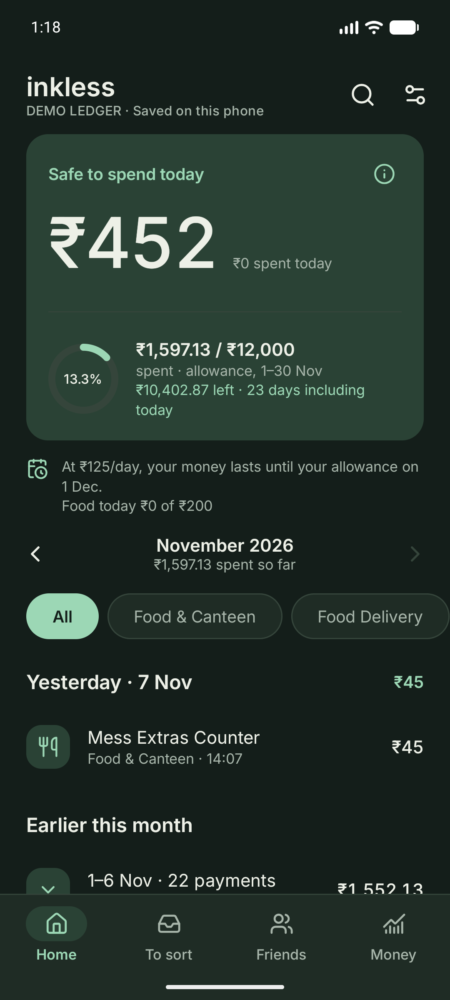
</p>

<p align="center">
  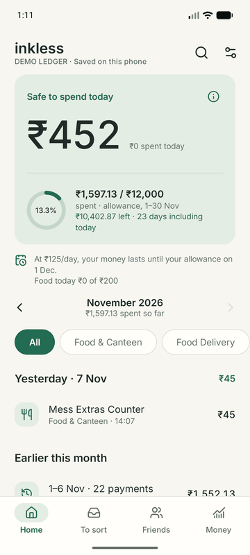
</p>

<sub>Screenshots use the built-in demo data — none of it is real.</sub>

**Want to try it?** [docs/INSTALL.md](docs/INSTALL.md) explains which APK to pick and how to install it (it's not on the Play Store, since apps that read SMS need Google's approval).

## What it does

- **Auto-capture from bank SMS** — payments show up within seconds of paying, from any UPI app. See [below](#auto-capture).
- **One payment, one entry** — the bank SMS and the GPay/PhonePe/Paytm notification for the same payment are merged. See [UPI app notifications](#upi-app-notifications).
- **Transfers aren't spending** — money moved between your own accounts shows as 🔁 and stays out of the totals; money from home is tagged as allowance.
- **Files itself, and learns** — known merchants go straight into the right category, a small model trained on your own sorting guesses the rest, and anything it isn't sure about is a one-tap question. See [Smart categories](#smart-categories).
- **Safe to spend today** — set your monthly allowance and the day it arrives; Home says what you can spend today and when the money runs out at this pace. See [Budget](#budget).
- **Break down a payment** — one ₹5,000 Amazon order of five things becomes five items in five categories, typed in or read from a screenshot of the order. See [Break down](#break-down).
- **Split with friends** — split a payment equally, by amounts or by percentages; only your part counts as your spending, and Inkless keeps track of who owes whom. See [Split with friends](#split-with-friends).
- **Insights** — spending alerts, payments that come round every week or month, your month wrapped up as a picture to share, and how well the guessing is going. See [Insights](#insights).
- **Ask Inkless** — *"How much on food this month?"*, *"Biggest payment in October"*, *"kitna kharcha kal?"*, answered from the phone's own data. See [Insights](#insights).
- **Locked and yours** — an optional app lock (fingerprint, face or screen lock), payments exported as a spreadsheet, and a password-locked backup file you can restore anywhere. See [Privacy & your data](#privacy--your-data).
- **Cloud backup** — everything is backed up to your account as you go; log in on a new phone and it all comes back. See [Cloud backup](#cloud-backup).
- **Four tabs** — *Home* for the month's spending, *To sort* for payments waiting on a category (with how many are waiting), *Friends* for who owes whom, and *Money* for the allowance, Insights, Ask Inkless and Wrapped. Each tab keeps its place while you look at another. The search icon on Home opens Ask Inkless and the sliders icon opens Settings.
- **Category tabs** — swipe between *All* and 13 categories (Food & Canteen, Food Delivery, Travel, Recharge & Subscriptions, Laundry & Hostel, Lent to Friends, …), each with its own monthly total and payment list.
- **Month at a glance** — the total spent this month up top; step back through previous months.
- **Day-by-day list** — payments grouped by day with a daily total, merchant name, time and UPI ID.
- **Refunds handled properly** — a refund is subtracted from the category it came back to, and money coming in (like the monthly allowance) never counts as spending.
- **Transaction details** — tap any payment to set its category, add a note, rename the merchant ("q8291…@ybl" → "Tapri near Block C"), or delete it.
- **Cash quick-add** — the *Cash* button in the app or on the home-screen widget, for spends no SMS will ever mention.
- **Demo mode** — *Try the demo* on the welcome screen opens a few months of made-up hostel spending, no account needed. The data is seeded, so it comes out the same every time.
- **Material 3** with light/dark theme and dynamic colour on Android 12+.

All amounts are stored as whole paise (`Long`), never floating point, and shown with Indian digit grouping (₹1,23,456.50).

## Auto-capture

<p align="center">
  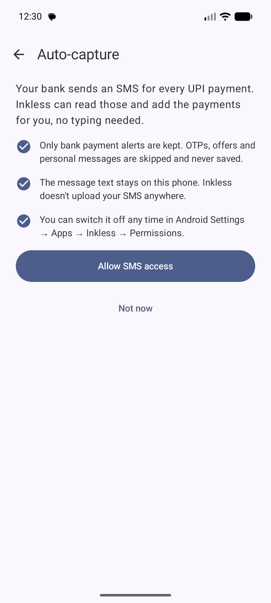
  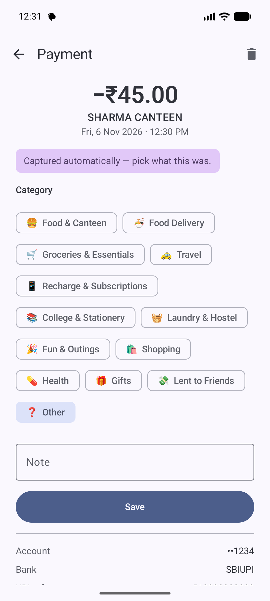
</p>

UPI apps have no API, but every bank sends an SMS for every UPI payment, whichever app was used. Inkless reads those:

- **Live** — a `BroadcastReceiver` picks up each bank SMS as it arrives and turns it into a transaction.
- **History** — on setup it can import the last 1, 3 or 6 months from the SMS inbox. This runs in WorkManager with a progress bar, and the same SMS is never saved twice.
- **Catch-up** — after logging back in, it quietly picks up any bank SMS that arrived in the meantime.
- **Bank-specific parsers** for SBI, HDFC, ICICI and Axis, built from real (masked) alerts, plus a generic UPI parser for everything else: amount, debit/credit, payee, UPI ID, account (last 4 digits), UPI reference and balance.
- **Refunds and reversals** are recognised (including SBI's `UPI/DRC` and `UPI/ONRF` codes) so they offset spending instead of counting as income.
- **Couldn't read these** — bank messages that look financial but no parser understood are kept in a list in Settings, so formats can be fixed instead of silently lost.

What it refuses to read matters just as much. A filter runs before any parsing and drops:

- **OTPs**, always and from any sender — they are never stored, not even as a hash.
- **Promotions and loan offers**, including anything from a promotional (`-P`) sender.
- **Failed payments, collect requests, mandate set-ups, balance reminders and telecom recharges** — money didn't actually move.
- **Personal messages and non-bank senders** — only bank-style sender IDs (`VM-HDFCBK`, `JK-SBIUPI-S`, …) are considered.

Each account turns capture on separately, nothing is captured in demo mode or while signed out, and the parsers live in the pure-Kotlin `:parsing` module with table-driven tests: every sample message in [`parsing/src/test/resources/parser-fixtures/`](parsing/src/test/resources/parser-fixtures/) states what it should be read as.

## UPI app notifications

<p align="center">
  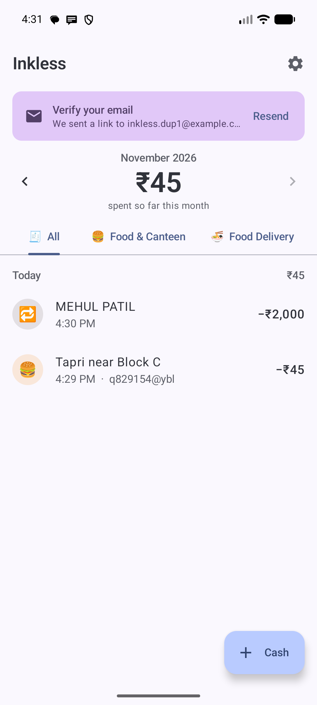
  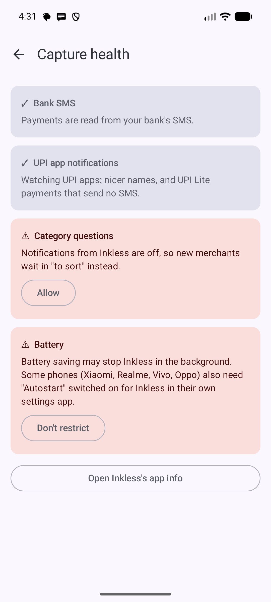
</p>

With notification access switched on, Inkless also reads payment notifications from UPI apps (Google Pay, PhonePe, Paytm, BHIM, Amazon Pay, CRED, super.money, Navi). It ignores every other app's notifications without reading them, and drops cashback, offers, requests, reminders and failed or pending payments. Notifications bring:

- **Names people recognise** — "Tapri near Block C" instead of `q829154@ybl`.
- **UPI Lite payments**, which send no bank SMS at all.

The same payment now usually arrives twice, so a deduplicator decides when two captures are one payment: the same UPI reference settles it; otherwise the same amount and direction within three minutes, from different sources, with payees that don't contradict each other (it allows for banks cutting names short and masking UPI IDs). Two SMS for the same amount are never merged — that's two chais. When they merge, the bank SMS wins on the money (amount, reference, account, balance), the notification wins on the name, and a category you already chose is kept.

**My accounts** (Settings) lists your own UPI IDs and your name as banks print it, plus home's UPI ID:

- Money to or from your own accounts is a **transfer**: shown with 🔁, never counted as spending or income.
- Money from home is **income tagged as allowance**.
- Money back from a merchant you paid at least as much in the last 30 days is a **refund** in that payment's category.

Adding or removing an account re-checks the last six months, so old transfers stop counting as spending straight away.

**Capture health** (Settings) shows whether SMS access, notification access, Inkless's own notifications and battery optimisation are set up, with a button straight to the system setting that fixes each one — including the *Allow restricted settings* step Android 13+ needs for apps installed from a file.

## Smart categories

<p align="center">
  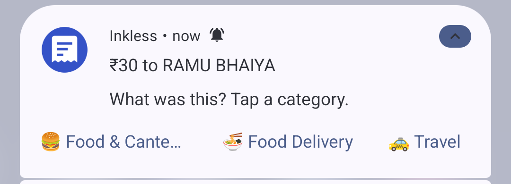
</p>
<p align="center">
  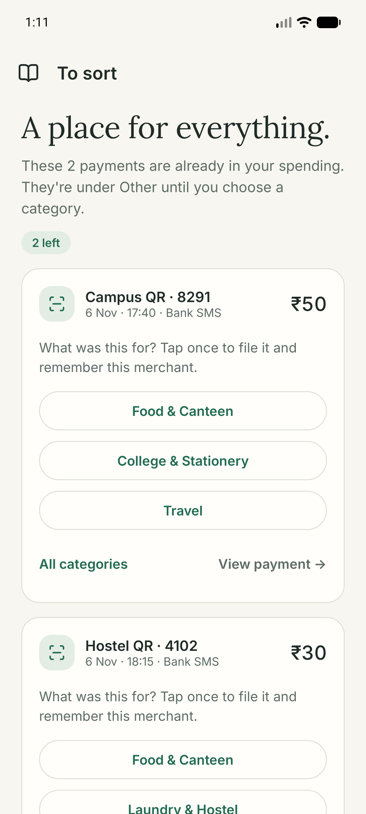
</p>

Every captured payment goes through a small categoriser, most specific knowledge first:

1. **Your rules** — Settings → Categorising rules, e.g. *UPI ID contains `canteen` → Food & Canteen*. They match the UPI ID, the payee name or either, by *contains*, *is exactly* or a regex, and run in the order you put them.
2. **Merchant memory** — once you've said what a merchant is, every later payment to it is filed the same way. This is what handles opaque QR handles like `q829154@ybl` and SMS that only carry a name ("trf to RAMU BHAIYA"), which no keyword can guess.
3. **The learned model** — a Naive Bayes classifier trained on the phone from every payment you've sorted. It looks at the payee's words (and pieces of words, so "Night Canteen" helps with "Block D Canteen"), the merchant itself (which counts most, once seen), the amount, the time of day and the day of the week, so ₹20 at 5 pm at an unknown QR code reads as chai. It files a payment on its own only when it's at least 80% sure and has learned from enough payments, and never learns from its own guesses until you confirm them.
4. **Built-in keywords** — Swiggy/Zomato → Food Delivery, Blinkit/Zepto/Instamart → Groceries, Uber/Rapido/IRCTC → Travel, Jio/Airtel/Netflix → Recharge & Subscriptions, and so on. Short keywords must be a whole word, so "ola" files *Ola* but not *Kolapur Stores*.
5. **Otherwise it asks.** A notification — *"₹30 to RAMU BHAIYA — what was this?"* — carries the model's best guesses (then your most-used categories) as buttons, and the payment's page opens with its best guess already picked; tapping one files the payment and teaches the merchant without opening the app. Anything still unsorted waits in the *To sort* tab (Home shows *N payments to sort* too), where one tap per merchant clears it.

Every correction retrains the model a moment later, so the next guess already knows. Teaching a merchant also files its other waiting payments, and payments captured before a rule or a merchant was known get re-sorted the next time the app opens. Anything you've categorised yourself is never changed.

## Budget

<p align="center">
  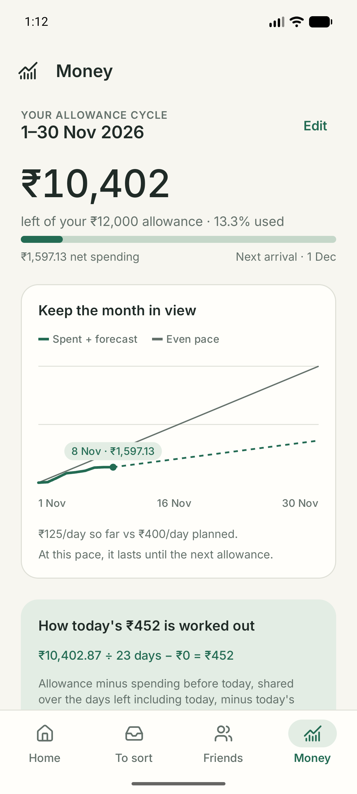
  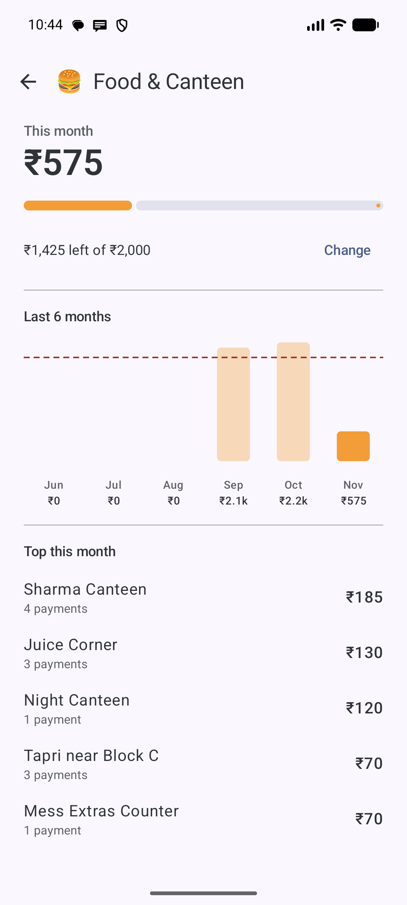
  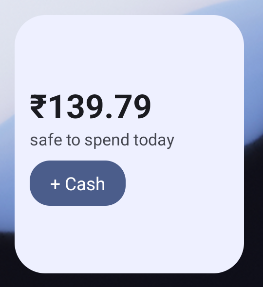
</p>

Set the monthly allowance and the day it usually arrives (Money → *Allowance and budgets*, or the card on Home). Each budget month runs from that day to the day before the next allowance, and everything below is about the current one:

- **Safe to spend today** — what was left this morning, spread evenly over the days until the allowance, minus what today has already taken. It turns into *over today's share* when today goes past it.
- **Spending ring and pace chart** — how much of the allowance is gone, and spending so far against an even pace that ends exactly at the budget.
- **Runway** — *"At this pace you'll run out on the 24th."* The pace is a weighted average of daily spending that leans on the last few days, so a spree shows up straight away.
- **Daily food cap** (optional) — canteen and food delivery against a daily limit, and how many days this month went over it (meals skipped at the mess).
- **Category budgets** — tap a category's total on Home for its page: this month against its budget, the last six months as bars, and the places the money went.
- **Semester total** — spending since July (or January), on the budget page.
- **Home-screen widget** — safe to spend today and a *Cash* button that opens the quick-add sheet. It updates as payments come in.
- **Weekly summary** — Sunday at 7 pm: the week's spending, the top three categories, and what's left until the allowance. It can be switched off on the budget page.

Every spend number (category totals, budgets, safe to spend, the widget, the summary) comes from one database view, `spend_parts`, which already splits broken-down payments into their items, counts only your part of a payment split with friends, and counts refunds against their category. Nothing adds up payments on its own, so the numbers always agree.

## Insights

<p align="center">
  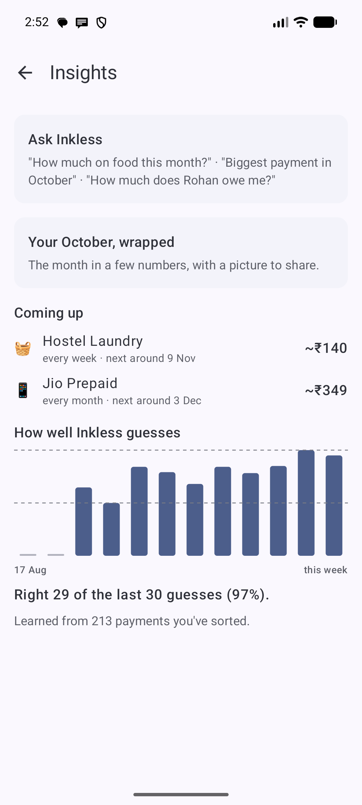
  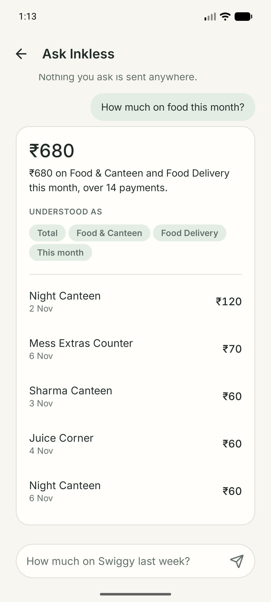
  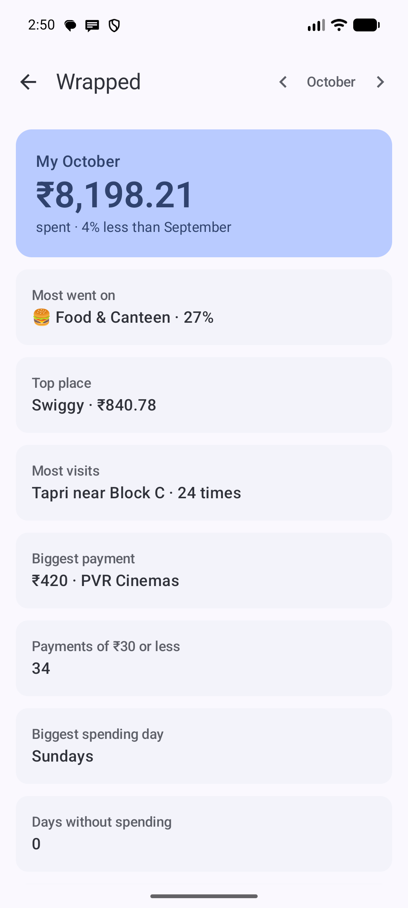
</p>

The *Money* tab opens *Insights*:

- **How well Inkless guesses** — every payment that arrives gets the model's guess before anyone sorts it. The chart shows, week by week, how often that guess matched the category the payment ended up in, next to how many payments Inkless filed by itself and you then changed. It's the number that should climb as you correct it. Replaying the demo's 215 payments in order (guess first, then learn the real category), the model is right 62% of the time over the first quarter and 100% over the last; the replay runs as a unit test, so the numbers stay honest. [`ml/`](ml/) compares it with a standard TF-IDF + logistic regression in scikit-learn (99.3% vs 100% on the last quarter of five months of demo data); that comparison is what showed the model was underrating the merchant itself.
- **Spending alerts** — *"🍜 Food Delivery: ₹1,240 this week. About 2.3× a usual week (₹540)."* "Usual" is the median of the last eight weeks (or 28 days), and "unusual" is measured with the median absolute deviation, so one big month can't skew it. It also has to be clearly more in rupees, and only categories you spend on most weeks (or most days) count, so a monthly recharge turning up on schedule isn't news. At most one notification a day, on its own quiet channel.
- **Coming up** — payments that come round every week, month or year (laundry on Mondays, the phone recharge on the 3rd), with roughly how much and when the next one is due. Something missed twice in a row drops off the list.
- **Wrapped** — any month in a few numbers: total and change on the month before, where most of it went, the top place, the most visited, the biggest payment, how many ₹30-or-less payments, the no-spend days. *Share as a picture* draws it as an image and opens the share sheet.
- **Ask Inkless** — questions in plain words, in English or a bit of Hinglish: totals, counts, the biggest payment, a daily average, top categories or places, for today, yesterday, a week, a month by name or the last N days, and what a friend owes. It's a small rule-based parser that turns the question into a query on the phone's own database: instant, offline, and it never makes a number up.

## Break down

<p align="center">
  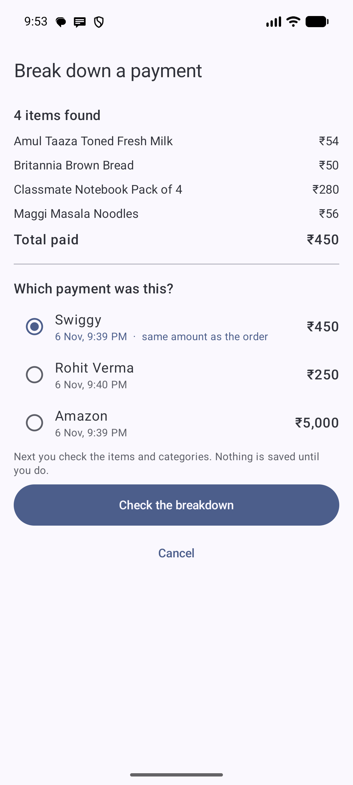
  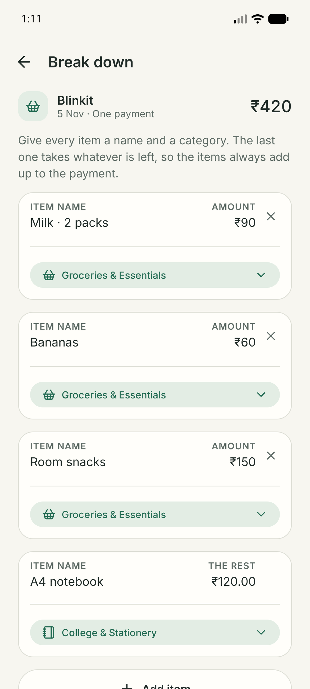
  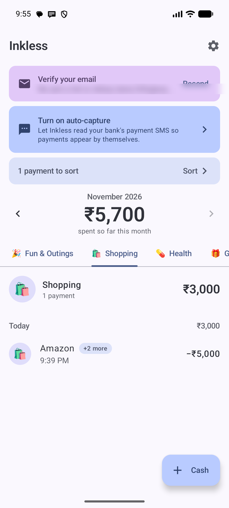
</p>

The bank and the UPI app only ever say "₹5,000 to Amazon", never what was in the order. *Break down* splits one payment into items, each with its own amount, category and note:

- **Editor** — type an amount, pick a category, next. The last item always takes whatever is left, so the items add up to the payment exactly, to the paisa.
- **Totals use the items** — each category counts only its own part, so the ₹5,000 order adds ₹3,000 to Shopping, ₹1,500 to College and ₹500 to Health. Merchant totals still see one ₹5,000 payment.
- **Listed once** — on Home the payment shows under its biggest item, with a *+2 more* badge; the other categories count their part without listing it again. *Back to one category* undoes it.
- **Asked at the right time** — after a payment over ₹100 (or ₹250, ₹500, ₹1,000, or never: it's a setting), the one notification that payment gets offers *Break down*. A payment Inkless filed on its own gets a quiet *"₹450 → 🍜 Food Delivery"* with *Looks right · Break down · Change*. Smaller payments stay quiet, and history imports never ask.
- **Share to Inkless** — share an order's screenshot (or its text) from Amazon, Flipkart, Blinkit or anywhere else. Inkless reads the items and prices on the phone, picks the recent payment with the same total, and opens the editor filled in, with a guessed category per item. Delivery, fees and discounts end up in the last item. Nothing is saved until you check it and tap *Save*.
- **Refunds** — money back for one item (same amount) goes back into that item's category; if it isn't clear which item it was, the refund waits in the review list.

Screenshots are read with [Tesseract](https://github.com/tesseract-ocr/tesseract) on the phone itself: no network, and the image and its text are never stored or uploaded. Its English model has no "₹", which it tends to read as "%", "=" or a "7" stuck to the price, so the order parser allows for that and uses the bill's total to tell "₹54" from "754". The parser lives in `parsing/` with fixture tests, including text Tesseract actually read off a test screenshot.

## Split with friends

<p align="center">
  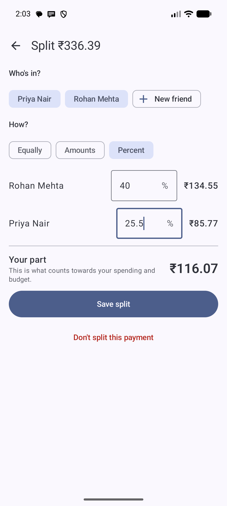
  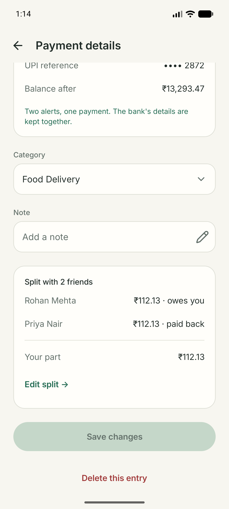
  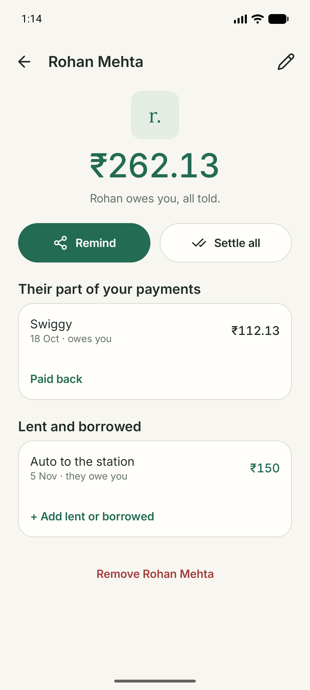
</p>

A dinner paid on your UPI isn't all your spending. *Split with friends* on a payment's details divides it:

- **Equally, by amounts or by percentages**, to the paisa. Whatever doesn't divide evenly stays with you, the payer, so nobody owes a fraction of a paisa more than their part.
- **Only your part counts** — categories, budgets, safe to spend and the widget see the ₹300 that was yours, not the ₹900 bill. On Home the payment shows *split · yours ₹300*.
- **Who owes whom** — the *Friends* tab shows each friend's balance: their unpaid parts of your payments, minus anything you owe them. Money lent or borrowed outside any payment (*"₹150, auto to the station"*) goes on the friend's page too.
- **Paid back, automatically** — when money arrives from a friend who owes you (matched by their UPI ID or their name) and it's the amount of something they owe, or all of it, a notification asks *"₹250 from Rohan: the ₹250 Rohan owed you?"*. *Mark paid back* ticks it off, and the repayment is filed as money back rather than income.
- **Remind** — sends a friend what they owe, item by item, through WhatsApp or anything else. If you've added your UPI ID under *My accounts*, the message ends in a `upi://pay` link with the amount filled in, so paying you is one tap.
- **Friends on Inkless** — add a friend's Inkless username and splits with them show up in their app under *Shared with you*. When they tap *I've paid*, it's ticked off on your phone too.

A payment is either broken down into items or split with friends, not both. A shared split holds everyone's username, the amounts, who has paid, and a short note with the merchant's name and the date; only the people in it can read it, and only you, the payer, can change the amounts or remove it.

## Accounts

<p align="center">
  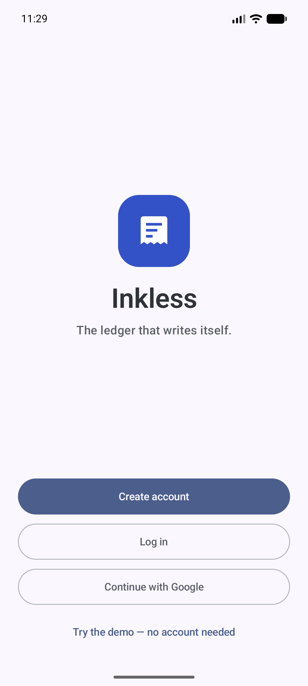
  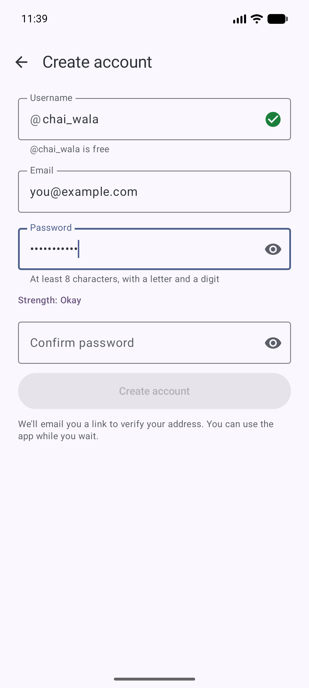
</p>

- **Sign up** with a username, email and password. The username is checked as you type, and the account gets a verification email (the app works while you wait, with a reminder on the home screen).
- **Log in** with your username *or* your email, or with **Continue with Google** (Android's Credential Manager account picker).
- **Forgot password** takes a username or email and sends a reset link.
- **Settings** — link Google to a password account, change password, log out, or delete the account (deletes its cloud backup and the splits it shared, frees the username and wipes its data from the phone).
- **Several people, one phone** — each account gets its own database file, so logging out and letting a friend log in never mixes your data.

Error messages are deliberately vague about whether an account exists: a wrong password and an unknown username get the same message, and the reset screen always says *"If an account exists, we've sent a reset link."*

## Cloud backup

<p align="center">
  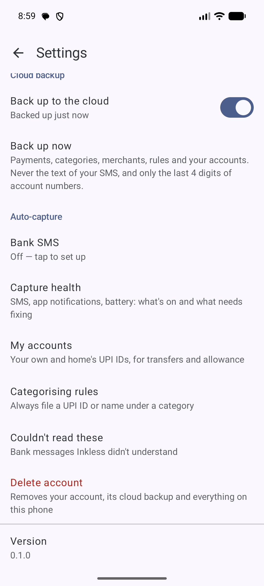
  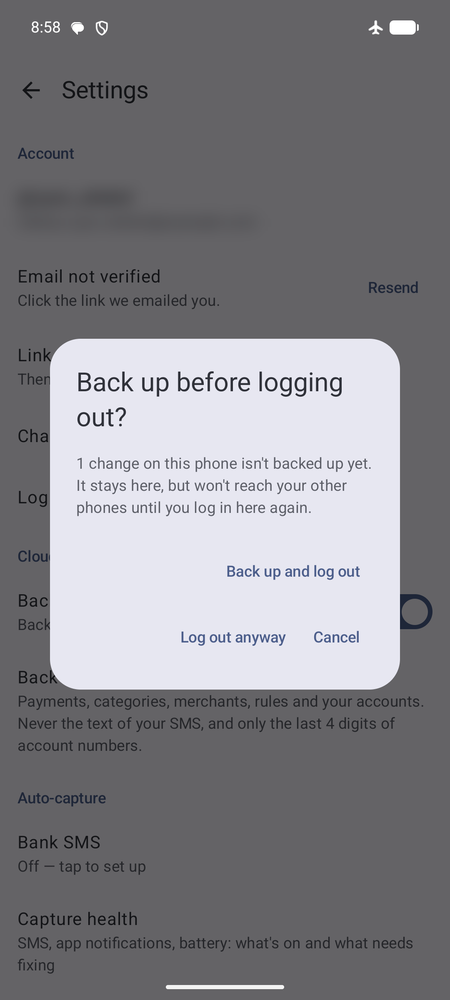
</p>

The phone's own database is always the real copy; the app reads nothing else, so it works the same offline. The cloud copy in Firestore exists so a new phone can get everything back.

- **What's backed up:** payments (with their breakdown), categories (with their budgets), the allowance, merchants (with the names and categories you taught them), rules, *My accounts*, friends, splits and money lent or borrowed. Never the text of an SMS or notification, and never more than the last 4 digits of an account number.
- **When:** a few seconds after any change, right after logging in, and every few hours as a safety net, using WorkManager so it only runs with a connection and retries when it fails. *Back up now* in Settings does it on the spot.
- **New phone:** log in and it downloads everything, with a *Restoring your backup…* card on the home screen while it does. If that phone's SMS inbox came back too, importing its history doesn't create duplicates of payments the backup already brought.
- **Two phones:** each upload and download only moves what changed since last time. When both phones changed the same payment, the later edit wins. Deleting something sends a "deleted" marker, so it disappears on the other phone too.
- **Logging out with changes not yet backed up** (say, offline) asks first: back up and log out, or log out anyway. They stay on the phone either way.
- **Switching backup off** applies to every phone on the account and deletes the cloud copy (after a confirmation); the phone keeps everything. Switching it back on uploads it all again. New accounts start with backup on.

## Privacy & your data

<p align="center">
  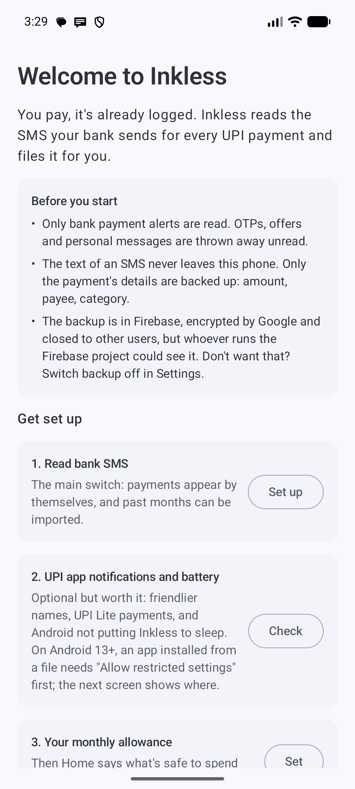
  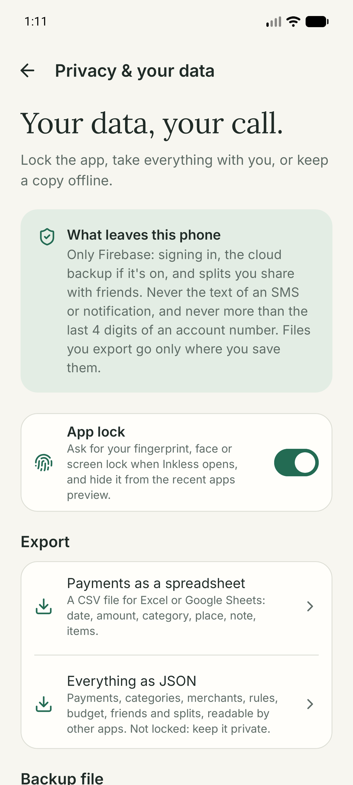
</p>

- **Get started** — a new account opens on a short checklist: what Inkless reads and what it never does, then each piece of setup (bank SMS, UPI app notifications and the *Allow restricted settings* step for apps installed from a file, battery, allowance, your own UPI IDs) with its status and a button to the screen that does it.
- **App lock** — Settings → *Privacy & your data*. Inkless then asks for a fingerprint, face or the phone's screen lock when it opens or comes back after 30 seconds, and stays out of the recent-apps preview. It uses Android's `BiometricPrompt`, so the app never sees the fingerprint or the PIN.
- **Export** — payments as a CSV for Excel or Google Sheets (with each split payment's own part and each broken-down payment's items), or everything as JSON. Files go wherever you pick in Android's own file picker; the app has no storage permission.
- **Backup file** — everything (payments and items, categories, merchants, rules, budget, friends, splits) in one file locked with a password: PBKDF2 stretches the password into a 256-bit key and AES-GCM encrypts the file and detects any change to it, all with what Android ships with. Restoring it, on any phone and into any account, adds what's missing and keeps whichever copy of each payment was edited last. Without the password the file is unreadable, and the password is never stored.

## Privacy

- Your transactions are stored in a Room database on the device, one file per account (`inkless_<id>.db`). Demo data lives in its own file and never mixes with anything else.
- SMS access is asked for in plain language first, and can be revoked any time from Android settings. Only bank transaction alerts are kept; the original text stays on the phone so it can be re-read if a parser improves, and is never uploaded. Notification access works the same way: only UPI apps' payment notifications are read, and their text never leaves the phone either.
- The only network traffic is Firebase: Authentication for sign-in, and Cloud Firestore for your username, profile, splits you share with friends and (unless you switch it off) the cloud backup. No analytics or ads SDKs. Firestore's own offline cache is kept in memory only, so there's no second copy of your data on disk.
- The category model is trained and stored on the phone, from your own payments, and isn't backed up: a new phone retrains it from the restored payments. Ask Inkless, the alerts, recurring payments and Wrapped are all worked out on the phone too. The Wrapped picture is only saved in the app's cache, and only leaves the phone if you share it.
- A shared order screenshot is read on the phone with Tesseract (whose English model, `tessdata_fast`, is Apache-2.0 and ships in the app), with no network at all; neither the image nor its text is kept. Only the breakdown you save is stored and backed up.
- Firestore security rules let each account read and write only its own data, and only the fields listed above: a document carrying anything else, such as message text or a full account number, is refused. A username can be looked up one at a time (that's how logging in with a username finds the email), but usernames can't be listed. A shared split can only be read by the people in it.
- The backup is encrypted in transit and at rest by Google, and other users can't read it, but whoever runs the Firebase project can see it in the Firebase console. If that's not OK for you, switch backup off.
- Inkless opts out of Android's automatic cloud backup and device-to-device transfer, so your spending data isn't copied anywhere behind your back.

## Tech

| | |
|---|---|
| Language | Kotlin |
| UI | Jetpack Compose, Material 3, Navigation Compose (type-safe routes, a nested graph per bottom tab so each keeps its own back stack); its own design system in `ui/theme` and `ui/components`: a fixed green palette in light and dark (it doesn't follow the wallpaper), Lora headlines and Inter text and numbers bundled in the app, Lucide line icons for categories |
| Architecture | MVVM, unidirectional data flow with `StateFlow` |
| DI | Hilt |
| Storage | Room (schema exported to `app/schemas/`, migrations tested against every past schema) |
| Accounts | Firebase Authentication, Cloud Firestore, Credential Manager (Sign in with Google) |
| Sync | Two-way, offline-first sync between Room and Firestore in WorkManager; last write wins, deletions as tombstones |
| Capture | `BroadcastReceiver` (SMS_RECEIVED), `NotificationListenerService`, SMS content provider, WorkManager |
| Sharing | Android share target and share sheet (`ACTION_SEND`), Tesseract OCR (Tesseract4Android) on the device, `upi://pay` links |
| Budget | Pure-Kotlin calculators, charts drawn with Compose `Canvas`, Jetpack Glance home-screen widget, weekly WorkManager job |
| Notifications | Notification actions handled by a `BroadcastReceiver`, deep links into the payment and Insights |
| On-device ML | Multinomial Naive Bayes in plain Kotlin (no ML library), retrained on every correction; robust statistics for alerts; a rule-based question parser |
| Async | Kotlin Coroutines & Flow |
| Security | `BiometricPrompt` app lock; backup files encrypted with PBKDF2 + AES-GCM (`javax.crypto`); R8 in release builds |
| Tests | JUnit, Truth, Turbine; Roborazzi screenshot tests on the JVM (Robolectric), with reference images in `app/src/test/screenshots/`; Compose UI tests; Room tests on a device/emulator; Firestore rules tests on the Firebase emulator; a scikit-learn notebook in `ml/` |
| Build | Gradle 9 (Kotlin DSL + version catalog), AGP 9, KSP |

minSdk 26 · targetSdk 37

## Architecture

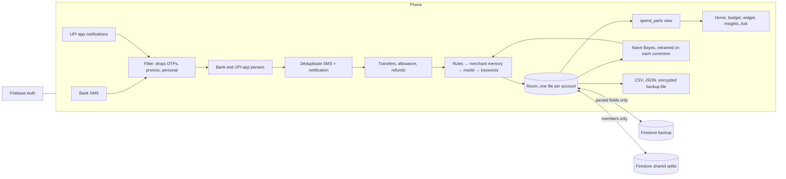

Everything to the left of Firestore happens on the phone. Raw message text stops at the parsers' input: it's kept on the phone for re-parsing, and never reaches the backup, the logs or any file the app writes.

## Project layout

```
app/        Android app — UI, Room database, accounts, SMS capture, Hilt wiring, demo data
parsing/    Pure Kotlin module (no Android dependencies): SMS filter, bank and UPI-app parsers, shared-order parser, test fixtures
firebase/   Firestore security rules, their tests, and Firebase setup steps
ml/         Notebook comparing the category model with a scikit-learn baseline, and its data
docs/       Screenshots, the tour GIF, the install guide, licences of the bundled fonts and icons
```

Inside `app/src/main/java/com/mehul/inkless/`:

```
auth/         Firebase sign-in, usernames, Google ID tokens, input validation
session/      Who's using the app (signed out, demo, an account) and which database is open
capture/      SMS receiver, notification listener, inbox import, the filter → parse → dedupe → save pipeline, transfer/refund classification
categorize/   Rules → merchant memory → keywords, re-sorting, and the "what was this?" notification
budget/       Allowance cycle, safe to spend, runway, food cap, semesters, the weekly summary
ml/           The category model: features, Naive Bayes, training, the replay evaluation
insights/     Spending alerts, recurring payments, Wrapped, the accuracy report
ask/          Ask Inkless: the question parser and the queries behind the answers
lock/         The app lock
export/       CSV and JSON export, the encrypted backup file and restoring it
widget/       The home-screen widget
breakdown/    Breaking a payment into items: the rules, and which notification a new payment gets
share/        Share to Inkless: reading a shared order (OCR for screenshots) and matching it to a payment
splits/       Friends and splits: the split maths, balances, matching repayments, reminders, splits shared with friends' apps
sync/         Cloud backup: Firestore mappers, the sync worker and its schedule, backup on/off
data/db/      Room entities, DAOs, DatabaseProvider (one database file per account)
data/repo/    Repositories the UI reads from
data/seed/    Default categories
demo/         Demo data generator and seeder
ui/           Compose screens, ViewModels, the theme and shared components, formatting
```

## Building

Requirements: JDK 17 or newer (21 recommended) and the Android SDK with platform 37.

The app needs an `app/google-services.json` from a Firebase project. It isn't committed; [`firebase/README.md`](firebase/README.md) walks through creating a free project and getting one.

```bash
# Debug APK -> app/build/outputs/apk/debug/
./gradlew assembleDebug

# Unit tests (JVM)
./gradlew test

# Screenshot tests: compare every screen with its reference image, or re-record the references
./gradlew verifyRoborazziDebug
./gradlew recordRoborazziDebug

# Room, migration, capture, dedupe, categorising, spending, splits and sync tests (needs a running emulator or connected phone)
./gradlew connectedDebugAndroidTest

# Firestore rules tests (needs Node and Java 21+)
cd firebase && npm install && npm test
```

**Release builds** are shrunk with R8 and signed with a key that never goes in the repo. Put a
`keystore.properties` next to `settings.gradle.kts` (it's git-ignored):

```properties
storeFile=/path/to/inkless-release.jks
storePassword=…
keyAlias=inkless
keyPassword=…
```

then `./gradlew assembleRelease` writes one APK per CPU type plus a universal one to
`app/build/outputs/apk/release/` (about 14 MB for arm64 against 36 MB universal: Tesseract's native
code is most of it). Without the file, release builds come out unsigned. For Google sign-in in a release
build, add the key's SHA-1 and SHA-256 to the Firebase app (see [`firebase/README.md`](firebase/README.md)).

On Windows use `gradlew.bat`. You can also just open the folder in Android Studio and hit Run.

**Installing from an APK file:** see [docs/INSTALL.md](docs/INSTALL.md). In short: Play Protect may refuse an SMS-reading APK opened from a browser or chat app (installing over USB with `adb install` works), and on Android 13+ the SMS permission starts out locked until *Allow restricted settings* is tapped on the app's info page. The in-app checklist walks through this too.

## Credits

- Fonts: [Lora](https://github.com/cyrealtype/Lora-Cyrillic) and [Inter](https://github.com/rsms/inter), both under the SIL Open Font License ([`docs/licenses/`](docs/licenses/)). They ship inside the app; nothing is downloaded.
- Icons: [Lucide](https://lucide.dev), ISC licence ([`docs/licenses/lucide-LICENSE.txt`](docs/licenses/lucide-LICENSE.txt)), converted to Android vector drawables.
